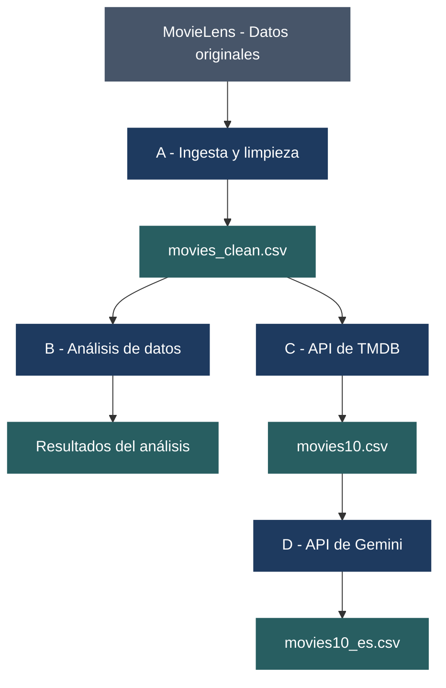

<div align="center">

# 🎬 Catálogo de películas

### Team Challenge · Data Analytics

Análisis de datos, integración de APIs e inteligencia artificial.


---

**9.742 películas · 100.836 valoraciones · 3.683 etiquetas**

</div>

## 📑 Índice

- [Descripción del proyecto](#-descripción-del-proyecto)
- [Equipo y reparto de funciones](#-equipo-y-reparto-de-funciones)
- [Flujo de trabajo](#-flujo-de-trabajo)
- [Tecnologías utilizadas](#-tecnologías-utilizadas)
- [Dataset](#-dataset)
- [Instalación](#-instalación)
- [Claves necesarias](#-claves-necesarias)
- [Ejecución](#-ejecución)
- [Resultados principales](#-resultados-principales)
- [Conclusiones](#-conclusiones)
- [Referencias](#-referencias)

---

## 🎯 Descripción del proyecto

Este proyecto tiene como objetivo desarrollar un catálogo de películas enriquecido a partir del dataset **MovieLens**.

Se realiza un proceso de ingesta, limpieza, transformación y análisis de datos utilizando Python y Pandas. Posteriormente, se enriquece la información mediante la API de TMDB y se utiliza Gemini para generar sinopsis en español.

El proyecto se desarrolla de forma colaborativa mediante Git y GitHub, distribuyendo las responsabilidades entre los cuatro integrantes del equipo.

## 👥 Equipo y reparto de funciones

| Integrante | Rol | Responsabilidad | Notebook |
|---|:---:|---|---|
| Alicia Gonzalez | A | Ingesta y limpieza de datos | `01_ingesta_limpieza.ipynb` |
| Gabriel Omar Marmolejo | B | Análisis de datos | `02_analisis.ipynb` |
| Javier Bittini | C | Enriquecimiento mediante TMDB | `03_tmdb.ipynb` |
| Pedro Martinez | D | Generación de sinopsis mediante Gemini | `04_gemini.ipynb` |

## 🔄 Flujo de trabajo



El flujo de trabajo comienza con la preparación de los datos originales. El catálogo limpio sirve como base tanto para el análisis exploratorio como para el enriquecimiento mediante TMDB. Finalmente, Gemini utiliza las sinopsis obtenidas para generar contenido en español.

## 🛠️ Tecnologías utilizadas

| Tecnología | Aplicación en el proyecto |
|---|---|
| Python | Lenguaje principal de programación. |
| Pandas | Limpieza, transformación y análisis de datos. |
| Jupyter Notebook | Desarrollo y documentación del código. |
| Visual Studio Code | Entorno de desarrollo. |
| Requests | Peticiones HTTP a la API de TMDB. |
| Python-dotenv | Gestión de variables de entorno. |
| TMDB API | Obtención de sinopsis y páginas web oficiales. |
| Google Gemini | Generación de sinopsis en español. |
| Git y GitHub | Control de versiones y trabajo colaborativo. |

## 📂 Dataset

El proyecto utiliza el dataset **MovieLens**, compuesto por los siguientes archivos:

| Archivo | Contenido |
|---|---|
| `movies.csv` | Información de las películas y sus géneros. |
| `ratings.csv` | Valoraciones realizadas por los usuarios. |
| `tags.csv` | Etiquetas asignadas a las películas. |
| `links.csv` | Identificadores externos de las películas. |

Durante el proceso de limpieza se extrae el año de estreno de las películas y se genera un archivo procesado que sirve como base para las siguientes etapas del proyecto.

## ⚙️ Instalación

### 1. Clonar el repositorio

```bash
git clone https://github.com/gonzalezsimancasalicia-cell/T10_Challenge.git
cd T10_Challenge
git switch Develop
```

### 2. Crear un entorno virtual

```bash
python -m venv venv
```

### 3. Activar el entorno virtual

**Windows (PowerShell):**

```powershell
.\venv\Scripts\Activate.ps1
```

**Linux o macOS:**

```bash
source venv/bin/activate
```

### 4. Instalar las dependencias

```bash
pip install -r requirements.txt
```

### 5. Configurar las variables de entorno

Crear una copia del archivo `.env.example` con el nombre `.env`.

**Windows (PowerShell):**

```powershell
Copy-Item .env.example .env
```

**Linux o macOS:**

```bash
cp .env.example .env
```

Completar el archivo `.env` con las claves personales de las API necesarias.

> [!IMPORTANT]
> Las claves de acceso son privadas y no deben incluirse directamente en los notebooks ni publicarse en GitHub.

## 🔑 Claves necesarias

| Variable | Dónde se obtiene |
|---|---|
| `TMDB_READ_ACCESS_TOKEN` o `TMDB_API_KEY` | [TMDB](https://www.themoviedb.org/) → Settings → API |
| `GEMINI_API_KEY` | [Google AI Studio](https://aistudio.google.com/) |

> [!NOTE]
> Las claves de las API son necesarias para los apartados de enriquecimiento y generación de sinopsis, pero no para los notebooks de ingesta, limpieza y análisis.

## 🚀 Ejecución

Los notebooks se encuentran dentro de la carpeta `TC_01_Movies/`.

Se debe utilizar dicha carpeta como directorio de trabajo, seleccionar el entorno virtual creado anteriormente como kernel de Python y ejecutar los notebooks en el siguiente orden:

| Orden | Notebook | Objetivo | Archivo generado |
|:---:|---|---|---|
| 01 | `01_ingesta_limpieza.ipynb` | Carga, inspección y limpieza de datos. | `movies_clean.csv` |
| 02 | `02_analisis.ipynb` | Unión de tablas y análisis exploratorio. | Resultados en el notebook. |
| 03 | `03_tmdb.ipynb` | Enriquecimiento mediante TMDB. | `movies10.csv` |
| 04 | `04_gemini.ipynb` | Generación de sinopsis en español. | `movies10_es.csv` |

Los archivos CSV generados se almacenan en:

```text
TC_01_Movies/data/processed/
```

## 📊 Resultados principales

<div align="center">

| Películas | Valoraciones | Etiquetas | Películas enriquecidas |
|:---:|:---:|:---:|:---:|
| **9.742** | **100.836** | **3.683** | **10** |

</div>

### A · Ingesta y limpieza

- Se realizó la ingesta y limpieza del catálogo original, identificando **13 películas** sin un año de estreno determinado.

### B · Análisis de datos

- El análisis de usuarios mostró una mediana de **70,5 valoraciones por usuario** y una puntuación media de **3,71** entre los usuarios menos activos, frente a **3,61** entre los más activos, calculadas a partir de las medias individuales de cada usuario.

- Se identificaron **279 películas** estrenadas entre 1950 y 1959.

- Se encontraron **306 películas** pertenecientes simultáneamente a los géneros Sci-Fi y Adventure.

- La etiqueta más frecuente fue `In Netflix queue`, con **131 apariciones**.

### C · Enriquecimiento mediante TMDB

- Se enriqueció una selección de **10 películas** mediante la API de TMDB.

- Se obtuvieron sinopsis para el **100 %** de la muestra y páginas web oficiales para el **40 %**.

### D · Generación de sinopsis mediante Gemini

- Se implementó y probó la generación de sinopsis breves en español a partir de las descripciones originales en inglés, facilitando la adaptación del catálogo al público hispanohablante.

## 💡 Conclusiones

La limpieza y transformación de los datos permite obtener una base de información estructurada y adecuada para su análisis.

El análisis exploratorio facilita la identificación de patrones en las valoraciones de los usuarios, la distribución de las películas por años y géneros, y el uso de etiquetas.

La integración de la API de TMDB permite ampliar la información original del dataset mediante sinopsis y páginas web oficiales, mientras que el uso de Gemini facilita la generación de contenido en español.

El proyecto combina tres áreas fundamentales:

- **Data Analytics:** limpieza, transformación y análisis de datos.
- **Integración de APIs:** obtención de información desde servicios externos.
- **Inteligencia artificial:** generación de contenido en lenguaje natural.

Todo ello aplicando una metodología de trabajo colaborativo mediante Git y GitHub.

## 📚 Referencias

- [MovieLens — GroupLens Research](https://grouplens.org/datasets/movielens/)
- [Documentación de Pandas](https://pandas.pydata.org/docs/)
- [Documentación de TMDB API](https://developer.themoviedb.org/)
- [Documentación de Google Gemini API](https://ai.google.dev/)

---

<div align="center">

### 🎬 Team Challenge · Catálogo de películas

Desarrollado de forma colaborativa por Alicia, Gabriel, Javier y Pedro.

**Python · Data Analytics · APIs · Inteligencia Artificial**

</div>
